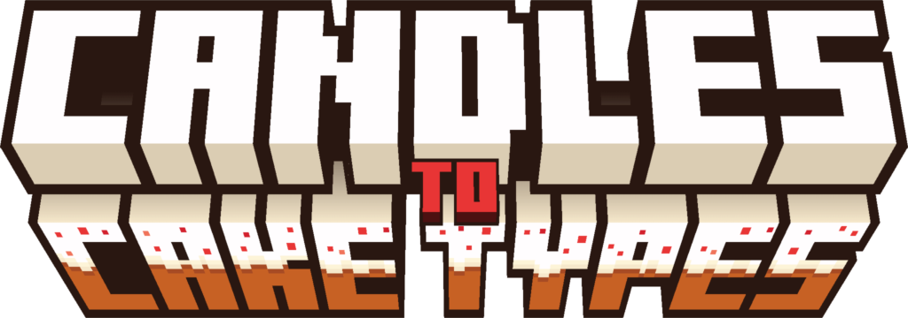
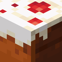
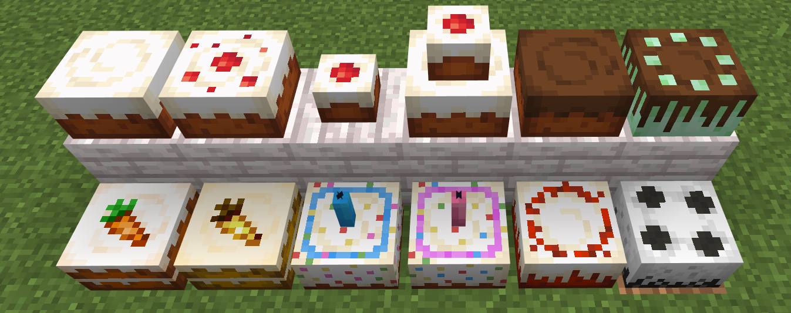

<p align="center">
  
</p>

<p align="center">
  <b>Java 1.17 → 26.3 &nbsp;•&nbsp; Bedrock via Geyser &nbsp;•&nbsp; Unofficial port by GalaxyModz</b>
</p>

<p align="center">
  <a href="../../releases/latest"></a>
  <a href="https://modrinth.com/resourcepack/cake-types"></a>
  
</p>

---

## 🎂 What is it?



**Candles to Cake Types** is a resource pack by **ARKK & ZAZ** that turns the plain Minecraft cake into **12 different cakes**. You don't need mods or commands, only candles.

This is an **unofficial port** by **GalaxyModz** that brings the pack to:

- 🌉 **Bedrock players on Geyser servers**, so they see the same cakes as Java players, with the same shapes
- ☕ **Java Edition 1.17 up to 26.3**, from one pack

## 📸 Showcase

<p align="center">
  
</p>

## ✨ What does it do?

Put a candle on a cake and it becomes a different kind of cake:

| Candle | Cake | | Candle | Cake |
|---|---|---|---|---|
| *(none)* | Cake without cherries | | 🟫 Brown | Chocolate cake |
| ⬜ White | Cherry cake | | 🟩 Lime | Mint chocolate cake |
| ⬜ Light gray | **Small** cake | | 🟧 Orange | Carrot cake |
| ⬛ Gray | **Two-layer** cake | | 🟨 Yellow | Golden carrot cake |
| 🟦 Light blue | Blue birthday cake 🕯️ | | 🟥 Red | Red velvet cake |
| 🩷 Pink | Pink birthday cake 🕯️ | | ⬛ Black | Cookies & cream cake |

🕯️ The birthday cakes keep their candle. On all the other cakes the candle disappears and only the cake type shows.
Other candle colors look like normal vanilla candle cakes.

## ⚙️ How does it work?

**In game**
1. Place a **whole** cake. You can't add a candle to a cake that has a bite taken out.
2. Right-click it with a candle. The cake changes into the cake type for that color.
3. **Light** the candle with flint and steel and it becomes a normal candle cake again. Blow it out and the cake type comes back.
4. **Eating** a slice drops the candle, as in vanilla.

**Under the hood**
- **Java:** Minecraft has a separate block model for every candle color on a cake. The pack replaces those models with the cake models, so no plugin is needed.
- **Bedrock:** a Bedrock resource pack can't change the shape of vanilla blocks. This port uses **Geyser custom block mappings** instead. Every *unlit* candle cake is sent to Bedrock players as a custom block with its own 3D model (full, small, two-layer, or with a candle). Lit candle cakes stay vanilla.
- **Multi-version:** the Java pack declares both the old and the new version fields in `pack.mcmeta`, so one pack loads from 1.17 to 26.3.
- **No cache clearing:** every release has a new version number but the same pack ID, so Bedrock players get updates automatically.

## 📥 Download

Get the files from the **[latest release](../../releases/latest)**:

| File | What it is | Where it goes |
|---|---|---|
| `CandlesToCakeTypes_Geyser.mcpack` | Bedrock resource pack | Geyser's `packs` folder |
| `candles_to_cake_types.json` | Geyser block mappings | Geyser's `custom_mappings` folder |
| `CandlesToCakeTypes_Java_1.17-26.3.zip` | Java resource pack | Your server resource pack, or your `resourcepacks` folder |

## 🌉 Server setup (Geyser)

1. Set the **Java pack** as your server resource pack, in `server.properties` or with your resource pack plugin.
2. Put `CandlesToCakeTypes_Geyser.mcpack` in Geyser's **`packs`** folder.
   - Spigot/Paper: `plugins/Geyser-Spigot/packs/`
   - Velocity/BungeeCord: the Geyser folder on your proxy
3. Put `candles_to_cake_types.json` in Geyser's **`custom_mappings`** folder (in the same Geyser folder).
4. In Geyser's `config.yml`, make sure this is on:
   ```yaml
   enable-custom-content: true
   ```
   On newer Geyser versions this setting is under `gameplay:`.
5. **Fully restart** the server or proxy. A reload is not enough.

**Updating:** replace the `.mcpack` and the `.json` with the new ones and restart. You don't need to clear any cache.

> [!NOTE]
> Bedrock **without** Geyser (single player or Realms) isn't supported. Bedrock doesn't let a resource pack give each candle cake its own look, so it only works through Geyser.

## 🔍 Java vs. Bedrock (Geyser)

| | Java | Bedrock via Geyser |
|---|---|---|
| All 12 cake types | ✅ | ✅ |
| Candle hidden on unlit cakes | ✅ | ✅ |
| Small and two-layer cake shapes | ✅ | ✅ |
| Birthday cakes (unlit) | ✅ | ✅ |
| Birthday cakes with a burning candle | ✅ | ⚠️ normal cake with a burning candle |

## ❓ Troubleshooting

| Problem | Fix |
|---|---|
| Bedrock players see normal candle cakes | Check `enable-custom-content: true`, check the `.json` is in `custom_mappings`, and fully restart |
| Cakes are invisible | The `.mcpack` and `.json` come from different releases. Use both from the same release |
| Purple and black textures | The `.mcpack` is missing from `packs`, or the player declined the resource pack |
| Two versions of the pack load | Remove old `.mcpack` files from the `packs` folder |

## 🙏 Credits

- **Original pack, textures, logo & idea:** [ARKK](https://modrinth.com/user/ARKK) & [ZAZ](https://modrinth.com/user/ZAZ). [Modrinth](https://modrinth.com/resourcepack/cake-types) · [Planet Minecraft](https://www.planetminecraft.com/texture-pack/candles-to-cake-types/)
- **Bedrock / Geyser port & multi-version update:** **GalaxyModz**
  - 📧 support@galaxymodz.com
  - 💬 Discord: GalaxyModz
  - 🐙 GitHub: [BetaDevlopment](https://github.com/BetaDevlopment)

Please support the original creators on [Modrinth](https://modrinth.com/resourcepack/cake-types)!

## 📄 License

The textures, logo, icon and original pack belong to **ARKK & ZAZ**.
The Geyser mappings and Bedrock cake models were made by GalaxyModz. See [LICENSE](LICENSE).

*Not affiliated with Mojang, Microsoft, GeyserMC, or the original creators.*
